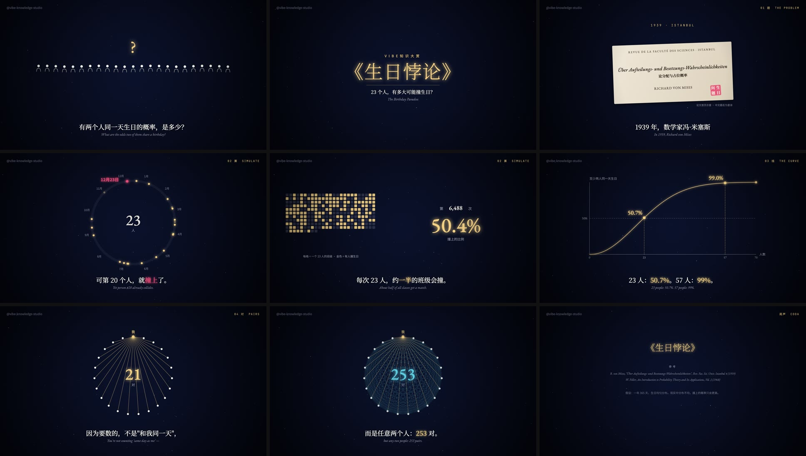

# Vibe Knowledge Studio

把一个知识点做成抖音「Vibe知识大赏」风格的无旁白知识短片：**代码逐帧绘制动画 + 中英双语字幕 + 代码合成配乐与事件音**，一条命令出 mp4 和封面。

既是一个 [Claude Code](https://claude.com/claude-code) Skill（`SKILL.md` 教 AI 从选题走到成片），也是一个可以单独用的小引擎（`engine/`）。



> 示例《生日悖论》：23 个人里两人同一天生日的概率超过一半。80 秒，全流程渲染约 70 秒（M 系列 Mac）。
> 片中的随机模拟、一万次试验、概率曲线都是真算出来的；57.5–60s 是"高潮后静音 2.5 秒"。

## 和别的复刻有什么不同

规范不是凭感觉写的，来自对 #vibe知识大赏 的实测（2026-10-22，详见 [`references/research.md`](references/research.md)）：

- **76 条视频的精确数据**：120–180s 这档总赞最高；收藏≈点赞 23%、转发≈27%、评论只有 1.6%；粉丝不到 1 万也能拿 5 万+ 赞
- **头部 8 条原片的音轨指纹**：至少 4 条用同一首 BGM（包络相关 0.80–0.94），它的重音在 17.1s——这就是"片名卡总在 15–20 秒出现"的原因
- **评论区**：《信息论》第一评"和我第一次玩纪念碑谷的感觉一样"（13.7 万赞）；《运气的形状》"我唯一能懂的就只有音乐了"

引擎把这些结论变成了可执行的东西：

| | |
|---|---|
| 三套世界 | `night` 夜曲（抽象概念）· `gilt` 鎏金暗场（编年史）· `paper` 宣纸水墨（国学/人生，适合竖屏） |
| 画幅 | 16:9 和 9:16，组件按短边自适应 |
| 字幕 | 中文 + 英文斜体副行；`[关键词]` 染金、`{负面词}` 染红 |
| 组件 | 文献复原卡、印章、规则卡、打字机、函数曲线、计数器、彗尾光点、扩散环、一帧闪亮…… |
| 配乐 | 代码合成，按段落写织体（pad / piano / full / arp / outro），满编进入那一拍自动加重音；也可引用你有授权的曲子 |
| 事件音 | 在画面代码里就地 `c.sfx(t, 'tick')`，音画不会错位；`hush` 做高潮后静音 |
| 体检 | 时长、片名卡时刻、字幕字数与停留、死帧、重音次数、静音段、参考文献 |
| 配乐分析 | `beats.mjs` 找外部曲的 BPM 和重音点，把片名卡对到拍上 |

## 安装

需要 Node ≥ 18、ffmpeg、Chrome（或 `npx playwright install chromium`）。

```bash
git clone <本仓库地址> ~/.claude/skills/vibe-knowledge-studio
cd ~/.claude/skills/vibe-knowledge-studio && npm install
npm run demo        # 渲染示例 → examples/birthday/out/生日悖论.mp4
```

在 Claude Code 里直接说：

> 用 vibe-knowledge-studio 做一条讲「幸存者偏差」的视频，竖屏

它会按 `SKILL.md` 的流程走：选题候选 → 事实核查表 → 字幕稿 → 分镜表 → 写 `film.js` → 关键帧自查 → 出片 + 体检 → 发布文案。每一步都会停下来给你确认。

其他能读文件、跑命令的 AI 也能用：让它先读 `SKILL.md`。

## 手动使用

```bash
mkdir -p films/my-film && cp templates/film.js films/my-film/
node engine/render.mjs films/my-film preview          # 浏览器里拖进度条
node engine/render.mjs films/my-film stills 3,12,60   # 导出关键帧
node engine/render.mjs films/my-film all              # → out/<片名>.mp4 + cover.jpg + qa.json
node engine/beats.mjs 你的配乐.mp3                     # 外部曲的重音点
```

一条片子就是一个 `film.js`：

```js
import { title } from '/engine/vibe.js';
export default {
  meta: { title: '生日悖论', world: 'night', size: '16:9', duration: 80, titleAt: 9.47,
          music: { bpm: 76, sections: [[0, 'pad'], [9.47, 'full'], [57.5, 'rest'], [60, 'piano']] } },
  subs: [[0.6, 3.6, '一个班，[23] 个人。', 'A class of 23.']],
  scenes: [
    { from: 0, to: 9.2, draw(c, k, lt) { c.type('床前明月＿', c.cx, c.cy, .8, 5, { size: 80, cursor: true }); } },
    title(9.47, 14.2),
  ],
};
```

API 见 [`references/engine.md`](references/engine.md)。

## 目录

```
SKILL.md                 给 AI 的工作流程
references/
  research.md            爆款数据与拆解
  script.md              选题公式、六段式、字幕写法、事实核查、发布文案
  visual.md              三套世界、版式、动效规则、母题库
  sound.md               配乐、事件音、静音、响度
  engine.md              film.js 格式与组件 API
engine/
  vibe.js                浏览器端运行时（背景、字幕、组件、事件收集）
  player.html            预览 / 渲染页
  render.mjs             逐帧渲染、出片、封面
  audio.mjs              配乐合成 + 事件音 + 混音 + 响度
  qa.mjs                 体检
  beats.mjs              外部配乐分析
templates/film.js        六段式起步模板（能直接渲染）
examples/birthday/       示例《生日悖论》
```

## 注意

- **配乐版权**：仓库不包含任何第三方音乐。话题里流行的那首 BGM 有版权，请用合成配乐或你有授权的曲子
- **事实核查**：AI 写的史料可能错。`SKILL.md` 把核查表设为必经步骤；再现历史文献一律标「图为示意」
- **平台规范**：发布时勾选"内容由 AI 生成"

## 致谢

拆解时交叉参考了这些开源项目的逐帧分析：
[xiazhuo123456789/vibe-knowledge-video](https://github.com/xiazhuo123456789/vibe-knowledge-video) ·
[HeyChengC/vibe-knowledge-film](https://github.com/HeyChengC/vibe-knowledge-film) ·
[LuZhong-Li/vibe-knowledge-video-skill](https://github.com/LuZhong-Li/vibe-knowledge-video-skill)。
本仓库代码为独立实现。

## License

[MIT](LICENSE)
